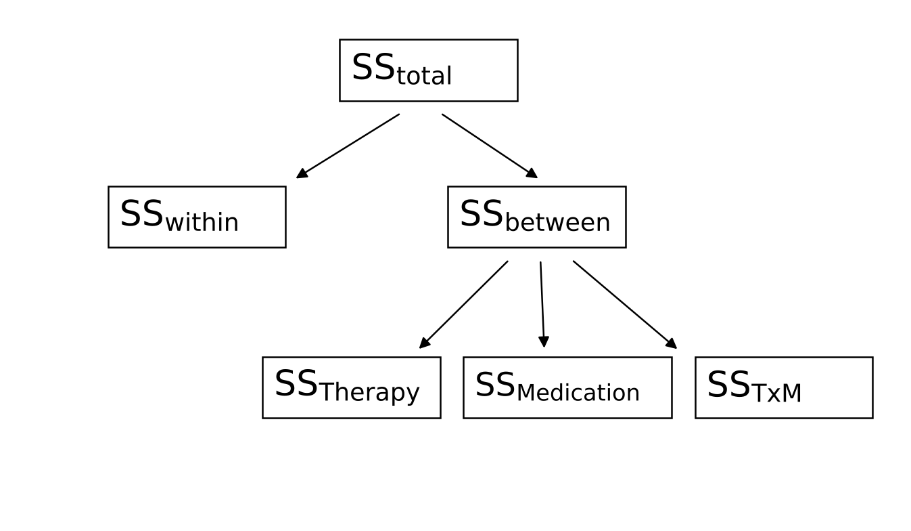
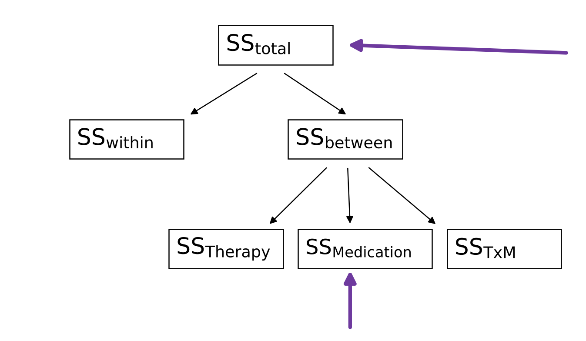
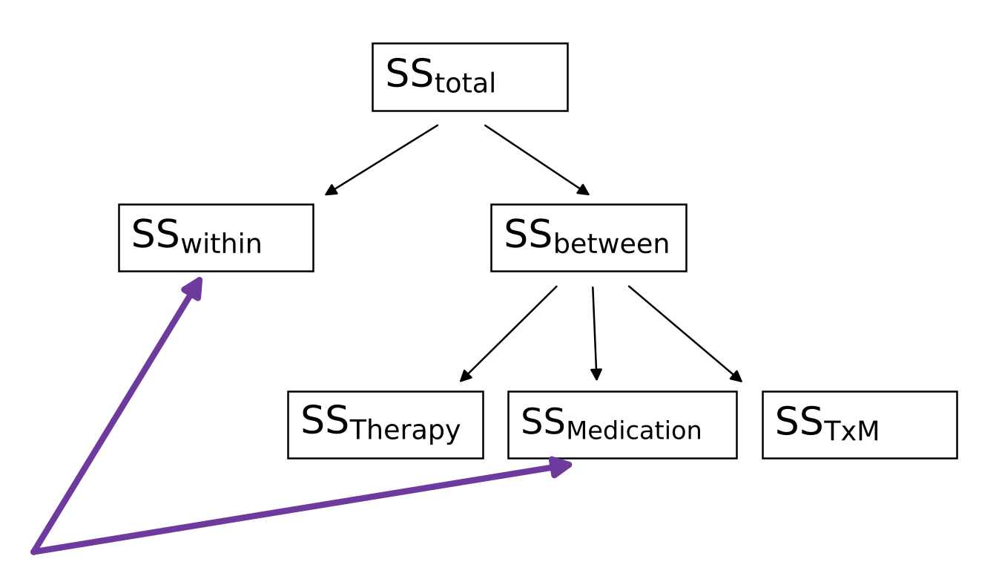
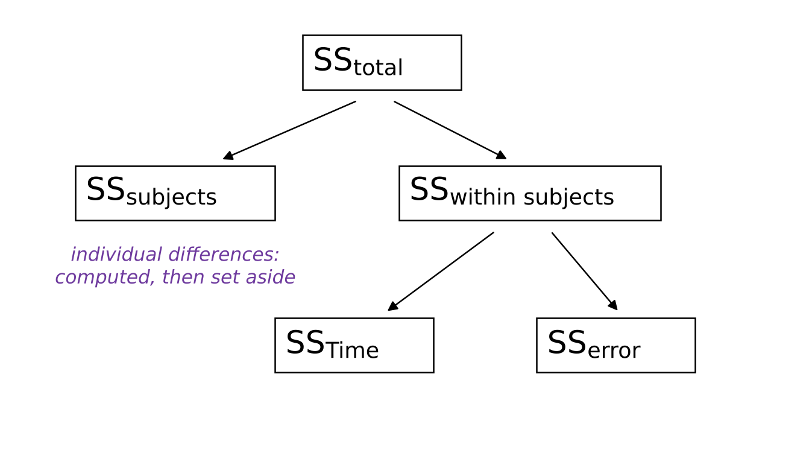
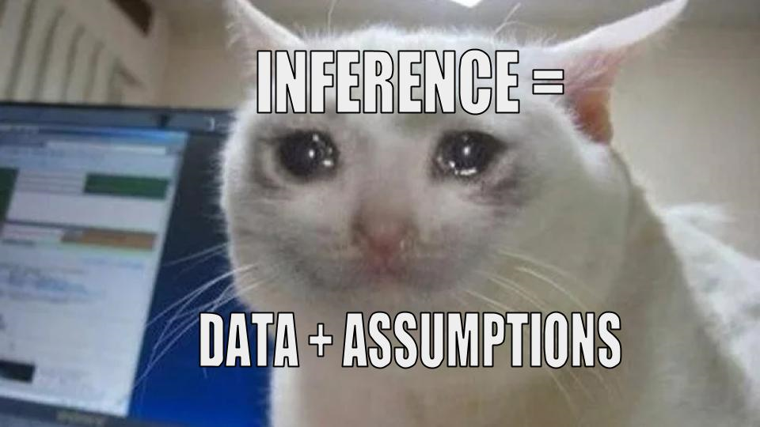

```{r xaringan-themer, include=FALSE, warning=FALSE}
library(xaringanthemer)
style_mono_accent(base_color = "#17139C",link_color = "#DD3E3E")

```

```{r packagesAndData, include=FALSE, warning=FALSE}
library(tidyverse)
library(ggpubr)
library(knitr)
library(kableExtra)
colors = RColorBrewer::brewer.pal(4, "Set2")

# formatting helpers
f0 <- function(x) formatC(x, format = "f", digits = 0)
f3 <- function(x) formatC(x, format = "f", digits = 3)
f2 <- function(x) formatC(x, format = "f", digits = 2)
pct <- function(x) formatC(100 * round(x, 3), format = "f", digits = 1)

# Therapy x Medication ANOVA table (images/fmedsfull2.png)
SS_therapy <- 50
SS_meds    <- 100
SS_int     <- 50
SS_w       <- 120   # error / residuals
SS_total   <- SS_therapy + SS_meds + SS_int + SS_w   # 320
```

## Last time

- 2x2 ANOVA with interactions

--

## Today

A series of spiels 

- **Finish up between-subjects ANOVA -- effect sizes!**
- **Within-subjects designs**
- ANCOVA
- Non-parametric tests

---

## Testing Ourselves

New 2x2 design comparing treatments to reduce depression

  * Therapy = Cognitive Behavioral vs. Meditation Training
  * Medication = With meds vs. Without meds
  

---

## Fill in the blanks


---
## Fill in the blanks -- Answer


---

## Fill in the blanks


---
## Fill in the blanks -- Answer


---
## Effect Sizes



---

## Eta-squared

$\eta^2 = \frac{SS_{\text{Effect}}}{SS_{\text{Total}}}$

.pull-left[

]

.pull-right[

$\eta^2_{\text{Medication}} = \frac{`r f0(SS_meds)`}{`r f0(SS_total)`} = `r f3(SS_meds / SS_total)`$
]

Proportion of the *total* variation in Y that is associated with membership in the groups defined by X. How much variance in depression is associated with Medication? `r pct(SS_meds / SS_total)`% of the *total* variance.

---

## Eta-squared

$\eta^2 = \frac{SS_{\text{Effect}}}{SS_{\text{Total}}}$

.pull-left[

]

.pull-right[

$\eta^2_{\text{Medication}} = \frac{`r f0(SS_meds)`}{`r f0(SS_total)`} = `r f3(SS_meds / SS_total)`$
]

Hard to compare across studies because it depends on everything else in the study: adding another factor that explains a lot of variance makes $SS_{\text{Total}}$ bigger and every other $\eta^2$ smaller.

---

### Partial eta-squared

$\eta_p^2 = \frac{SS_{\text{Effect}}}{SS_{\text{Effect}} + SS_{\text{Error}}}$

.pull-left[

]

.pull-right[

$\eta^2_{p,\text{Medication}} = \frac{`r f0(SS_meds)`}{`r f0(SS_meds)` + `r f0(SS_w)`} = `r f3(SS_meds / (SS_meds + SS_w))`$
]

Leaves the other effects out of the denominator. Of the variance in depression *not* explained by Therapy or the interaction, `r pct(SS_meds / (SS_meds + SS_w))`% is associated with Medication.

.small-text[
In one-way ANOVA, $\eta^2 = \eta^2_p$. With more factors, $\eta^2_p \geq \eta^2$, so don't compare your $\eta^2_p$ to someone else's $\eta^2$.
]

---
## Assumptions of ANOVA

1. Experimental errors are normally distributed (more later)

2. Equal variances between treatments. Aka homogeneity of variances.

3. Independence of samples (more next)

--

### What happens when we break some of these assumptions?

---
class: inverse, center, middle

# Within-subjects ANOVA

---

## What is it?

- Other names: within-groups, repeated measures

- Each subject contributes a score to each level of an independent variable (breaking independence assumption)

- We've done this before...paired $t$-test

  - Pre vs. Post

---

## Why does this matter?

- Some of the variability in the scores within a level of a factor is predictable if you know which participant contributed the score.

- If you could remove the variability that goes with the differences between the participants, you could reduce the variability within a level of the factor.

  - Same participants, or paired in some way (matched)

---

## Repeated Measures ANOVA

- You can calculate, and then discard, the variability among the means that comes from differences between the subjects

  - What does this mean if you want to know about individual differences?

--

- The remaining variability in the dataset is then partitioned into 2 components:

  1. variance due to differences between treatments/conditions/levels
  2. variance due to error (like measurement error, random noise etc.)

---

## Partitioning the variance



$F = \frac{MS_{\text{Time}}}{MS_{\text{error}}}$. $SS_{\text{subjects}}$ never makes it into the $F$-ratio.

---

### What changes in the calculations? 

- Restricted Model: $\Sigma D_i^2$

  - The null is that there is no difference in the participants' scores between conditions
  - Take the difference scores, square them, sum them up
  - $df_r$ = how many difference scores there are; you do not remove a df because you don't use a mean

---
### What changes in the calculations?

- Full Model: $\Sigma(D_i - \bar{D})^2$

  - The full model/alternative hypothesis is that there is a difference in the participants' scores between conditions
  - Take each individual's difference score and find the deviation for that difference score from the mean difference score of the sample. Square it, sum it up.
  - EX: pre = 8, post = 10, diff = 2
  - EX: if the average of the difference scores was 5, you would then do `2 - 5 = -3`
  - $df_f$ = number of difference scores - 1; you lose 1 df because you calculated the mean of difference scores

--

With 2 conditions, each person has exactly **one** difference score. Hold that thought.

---

## The Consequences -- Good

- Same participants = less time and effort

- Statistical POWER!
  - What goes into our F-statistic? $\frac{MS_{btwn}}{MS_{error}}$
  - The smaller $MS_{error}$, the larger the $F$-statistic
  - The repeated design allows you to remove the between-subject variability, so $MS_{error}$ gets smaller

---

## The Consequences -- Bad

- Often not feasible

- Order effects

  - Everyone gets Chocolate -> Vanilla -> Strawberry
  - How do you know that eating chocolate ice cream first doesn't change the way vanilla tastes to participants?
  - You need to counterbalance! (some get c -> v -> s, some get v -> s -> c etc...)

- Time elapsed can be...tricky

  - Take Josh Jackson's Applied Longitudinal class
  - Take Emily Wilroth's Hierarchical Linear Modeling class

---

## Toy data: 3 time points

Depression scores for 8 people at the start of treatment, 6 weeks, and 12 weeks.

```{r toydata, echo = FALSE}
dep_wide <- tribble(
  ~id, ~week0, ~week6, ~week12,
    1,     44,     39,      33,
    2,     23,     23,      19,
    3,     26,     22,      18,
    4,     28,     29,      28,
    5,     24,     25,      23,
    6,     24,     20,      18,
    7,     34,     34,      33,
    8,     29,     25,      18
)

# long format: one row per person per time point
dep_long <- dep_wide %>%
  pivot_longer(week0:week12, names_to = "time", values_to = "dep") %>%
  mutate(id   = factor(id),
         time = factor(time, levels = c("week0", "week6", "week12")),
         wave = as.numeric(time))   # 1, 2, 3 -- used later

dep_wide %>%
  kable(align = "c") %>%
  kable_styling(font_size = 18)
```

---

## Sphericity

With 3 time points, each person now has **three** difference scores:

- week 0 $-$ week 6
- week 6 $-$ week 12
- week 0 $-$ week 12

--

**Sphericity:** the variances of the difference scores for *every pair* of levels are equal.

--

With only 2 conditions there is only one difference score, so there is nothing for it to be unequal to. That's why sphericity never came up with the paired $t$-test.

---

## Difference scores in the toy data

```{r diffs}
diffs <- dep_wide %>%
  mutate(`0 - 6`  = week0 - week6,
         `6 - 12` = week6 - week12,
         `0 - 12` = week0 - week12)

diffs %>%
  summarise(across(`0 - 6`:`0 - 12`, var)) %>%
  round(2)
```

```{r diffvars, include = FALSE}
v_06  <- var(diffs$`0 - 6`)
v_612 <- var(diffs$`6 - 12`)
v_012 <- var(diffs$`0 - 12`)
```

The 0 $-$ 12 difference is about `r round(v_012 / mean(c(v_06, v_612)), 1)` times as variable as the other two. Not very spherical.

---

## Why are they unequal?

The variance of a difference score is the variance of the first score, plus the variance of the second score, *minus* (twice) how much they covary.

--

So: **the more correlated two measurements are, the smaller the variance of their difference.**

```{r cors}
dep_wide %>% select(-id) %>% cor() %>% round(2)
```

```{r corvals, include = FALSE}
r <- cor(dep_wide[, -1])
```

Weeks 0 and 6 correlate `r f2(r["week0", "week6"])`; weeks 0 and 12 correlate `r f2(r["week0", "week12"])`. So the 0 $-$ 12 difference has the largest variance.

---

## This is the rule, not the exception

In human data, measurements close together in time are more alike than measurements far apart.

- Your mood today predicts your mood tomorrow better than it predicts your mood next month
- Correlations shrink as the gap between measurements grows

--

Sphericity requires (roughly) that every pair of time points be equally correlated. But humans aren't like this...

Longitudinal designs break sphericity by design (almost)

---

### Difference scores are noisy

Every observed score = true score + measurement error.

--

When you subtract two scores from the same person:

- The **stable** part of the true score cancels out (that's the point!)
- The **measurement error does not cancel**. The difference score carries the error from *both* measurements.

--

So a difference score has less signal and more noise than either score it came from. And the more correlated the two measurements are, the worse this gets: after subtracting, most of what's left is error (Cronbach & Furby, 1970).

---
### Difference scores are noisy

Every observed score = true score + measurement error.

When you subtract two scores from the same person:

- The **stable** part of the true score cancels out (that's the point!)
- The **measurement error does not cancel**. The difference score carries the error from *both* measurements.

The irony: the high correlation that gives repeated-measures designs their power is the same thing that makes each person's difference score unreliable. And sphericity is an assumption about the variances of these noisy values.

---

### Shelly hates within-subjects ANOVAs

- When you have a within-subjects variable, our homogeneity assumption expands out to "sphericity"
- Rather than the groups having the same variances, now it's the variances of the DIFFERENCE SCORES between every pair of levels that have to be equal
- **At best you get the same answer as you would with a multilevel model**
- At worst, you've violated assumptions (rather aggressively) and therefore it's not valid to interpret the results
- More important: if you have within-subject variance, just explicitly model it!

---

### Same numbers, two ways: repeated measures ANOVA

```{r rmanova}
rm_anova <- aov(dep ~ time + Error(id / time), data = dep_long)
summary(rm_anova)
```

`Error(id / time)` tells `aov()` that `time` is nested in person: pull out the person-to-person variability (`Error: id`) and test `time` against what's left (`Error: id:time`).

---

### Same numbers, two ways: multilevel model

```{r mlm, message = FALSE}
library(lmerTest)   # lme4's lmer(), plus F-tests and p-values
m_ri <- lmer(dep ~ time + (1 | id), data = dep_long)
anova(m_ri)
```

`(1 | id)` gives every person their own intercept, i.e., their own average level of depression. That's the "subjects" variance from the ANOVA.

Same $SS$, same $MS$, same $df$, same $F$, same $p$.

---

## Why they match

- The random-intercept model assumes every pair of time points is *equally* correlated (called **compound symmetry**), which is a stricter version of sphericity

- So a repeated-measures ANOVA *is* a multilevel model, with one specific assumption baked in that you can't change

--

- The match only holds with complete, balanced data. If someone misses a time point, RM ANOVA drops that person entirely; the multilevel model keeps everything they did give you

---

## So model it

In a multilevel model, the correlation structure is something you *choose* and can *test*. An autoregressive (AR1) structure lets correlations shrink as time points get further apart:

```{r ar1, message = FALSE}
library(nlme)
m_cs  <- lme(dep ~ time, random = ~ 1 | id, data = dep_long)
m_ar1 <- lme(dep ~ time, random = ~ 1 | id, data = dep_long,
             correlation = corAR1(form = ~ wave | id))
anova(m_cs, m_ar1)
```

The AR1 model fits better (lower AIC, significant likelihood ratio test). The RM ANOVA can't even ask this question.

---
class: inverse, middle, center

# Analysis of Covariance (conceptually)

---

## ANCOVA: it's just regression

You want a group difference while *controlling for* another variable (a **covariate**): baseline severity, age, SES, etc.

Add the covariate to both models:

$$\text{Restricted: } Y_{ij} = \mu + \beta X_{ij} + e_{ij}$$
$$\text{Full: } Y_{ij} = \mu + Group_{j} + \beta X_{ij} + e_{ij}$$

--

In R, that's `lm(y ~ group + covariate)`: a regression with one categorical and one continuous predictor.

- Can increase power, *if* the covariate is related to $Y$ (it soaks up error variance)
- Much more next semester

---

## Teaser: Lord's paradox

Lord (1967): a university weighs students in September and again in June. Did the dining hall diet affect men and women differently? On average, neither group's weight changed.

--

- **Analyst 1** compares change scores: no change in either group, so no difference

- **Analyst 2** runs an ANCOVA controlling for September weight: men gained more than women *who started at the same weight*

--

Same data, opposite conclusions, and neither analyst did the math wrong. (In a randomized experiment, ANCOVA on baseline is the standard, recommended analysis.)

---
class: inverse, middle, center

# Non-parametric Tests

---

## Normality Assumption

- $H_0 : Y_{ij} = \mu + \epsilon_{ij}$
- $H_1 : Y_{ij} = \mu_j + \epsilon_{ij}$

- $t$-tests and ANOVA make the *same* assumption: the errors, $\epsilon_{ij}$ (your residuals), are normally distributed. Lots more next semester.

- Check with QQ plots (more common) or the Shapiro-Wilk test
  - Play with QQ plots: [https://xiongge.shinyapps.io/QQplots/](https://xiongge.shinyapps.io/QQplots/)
  - How to read them: [this Stack Exchange thread](https://stats.stackexchange.com/questions/101274/how-to-interpret-a-qq-plot)

---

## Who cares?

Some violations matter more than others:

- **Non-normal residuals:** ANOVA is fairly robust with moderate sample sizes
- **Unequal variances:** matters more, especially when group sizes are unequal
- **Non-independence:** matters most (see: everything we just did with within-subjects designs)

.center[

]

---

## Non-parametric tests exist

- Usually based on the rank order of the data (and medians instead of means)
- Worth considering when the DV is ordinal, or the data are badly skewed (reaction times, household income)
- The cost: usually less power when the parametric assumptions *do* hold, and effect sizes/CIs can be awkward

--

**You don't need to memorize these.** If you get to a point where you need one, search "non-parametric version of ___ test" and investigate from there.

--

Other options worth knowing exist: transformations (e.g., log reaction times), bootstrapping, robust methods, and ordinal regression for ordinal outcomes.

---

.small[
| Parametric Test | Situation | Non-Parametric Version|
|-----------------|-----------|-----------------------|
|Single sample *z* | sample mean vs population mean with known $\sigma$ | ¯\\_(ツ)_/¯  |
|Single sample *t* | sample mean vs population mean with unknown $\sigma$ |*Wilcoxon Signed-Rank Test*|
|Paired samples *t* |Compare 2 means with within-groups design|*Wilcoxon Signed-Rank Test*|
|Independent samples *t* |Compare 2 means with between-groups design|*Mann-Whitney U Test*|
|Oneway ANOVA (btwn groups)|Compare 3+ levels of IV|*Kruskal-Wallis H Test*|
|Oneway ANOVA (repeated measures)|Compare 3+ levels of IV|*Friedman Test* |
|Twoway ANOVA|2+ IVs (main effects/interactions)|*Aligned Rank Transform (ART) ANOVA* (`ARTool` package) |
|Correlation| Relationship between 2 continuous vars| *Spearman Rank-Order Correlation*|
]

---
class: inverse

# Next time

- THANKSGIVING!!
- Lab Assignment 3
- Exam 3
- Very sad goodbye's until January
